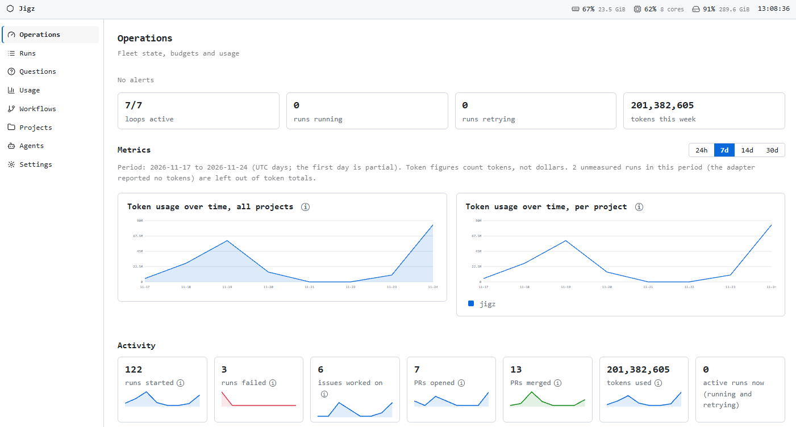

# Jigz

[](https://github.com/kinged007/jigz/actions/workflows/ci.yml) [](https://github.com/kinged007/jigz/releases) [](go.mod)

Run autonomous coding agents against your GitHub issues and pull requests.

`jig` watches a repository's issues and pull requests. For each labeled item
it starts an AI coding agent that reads the issue, writes the code, and moves
the work forward: planning, implementing, reviewing and merging. You manage
the backlog by adding labels and assigning issues. GitHub is the only
supported tracker.



## Features

- One command per repo: `jig setup`, then `jig` runs every loop in the foreground (or `jig start` in the background) plus a read-only web dashboard.
- Label-driven backlog: add `agent:build` to an issue and the agent plans, codes, opens a PR, and chains through review to merge.
- Two loops in the config that setup writes: `issues` (plan, build, docs) and `prs` (review, review-fix, merge); add a `work:` entry to add a loop.
- Spend and schedule guardrails: per-loop token budgets, working hours, idle sleep, and workspace cleanup.
- Fleet support: agent accounts and pools with usage-limit failover, and one shared dashboard across repos (`--unite`).

## Quickstart

```sh
# once per machine (macOS/Linux): installs jig to ~/.local/bin/jig
curl -sSL https://raw.githubusercontent.com/kinged007/jigz/main/install.sh | sh
export GITHUB_TOKEN="ghp_..."   # or GH_TOKEN; needs Contents, Issues, Pull requests read/write

cd your-repo
jig setup     # writes .jigz/, generates the workflows, creates the labels in config.yaml, installs the engine
              # (jig setup --skip-build leaves out the workflows and labels)
jig           # run every loop in the foreground (Ctrl-C stops all)
```

Then, on GitHub: assign an issue to yourself and add the `agent:build` label.
The loop polls roughly every 60 seconds, claims the issue, works on a
`auto/<issue-number>` branch, and opens a PR labeled `agent:review`.
See [docs/usage.md](docs/usage.md) and
[docs/concepts.md](docs/concepts.md).

## Supported agents

Each loop runs one agent CLI. Claude Code is the default; switch with the
`runtime` of an agent in `.jigz/config.yaml`
([Agent runtimes](docs/configuration.md#agent-runtimes)).

| Agent CLI | Runtime | Default command |
|---|---|---|
| [Claude Code](https://code.claude.com/docs/en/cli) | `claude-code` | `claude` |
| [pi](https://github.com/badlogic/pi-mono) | `pi` | `pi` |
| Codex | `codex` | `codex app-server` |
| OpenCode | `opencode` | `opencode` |
| GitHub Copilot CLI | `copilot-cli` | `copilot` |

Dashboard transcripts and stdout-based usage-limit detection cover Claude Code
and pi; other agents are detected from stderr. See
[Customizing agents](docs/customization.md#agents-and-models).

## Requirements

- macOS or Linux, on Intel or Apple silicon. Windows is not supported.
- A GitHub token with `repo` scope (classic) or Contents, Issues, Pull requests read/write (fine-grained); see [the token setup](docs/install.md#github-token).
- The [gh CLI](https://cli.github.com/) on `PATH`.
- A coding agent CLI installed and logged in; Claude Code (`claude`) is the default. See [Supported agents](#supported-agents).
- Go 1.26.0 or newer only to build from source.

## How it works

Every loop polls GitHub roughly every 60 seconds with a search query built
from trigger labels plus `in-progress`, scoped to `assignee:@me` and
excluding `needs-human`. Claiming an item adds `in-progress`; the agent
works on an `auto/<issue-number>` branch and routes its output through
labels: `build` opens a PR labeled `agent:review`, `review` sends it back
as `agent:build` or stops at `agent:done`, and an approved PR waits for a
person to label it `agent:merge`. Because the trigger stays on the item
for the whole run, an interrupted loop finds it again on the next poll.
Details: [docs/concepts.md](docs/concepts.md).

## Dashboard

Every run serves a read-only web dashboard at `http://127.0.0.1:7677`. It shows
the state of each loop, token use against budgets, and the history of every
run.


See [docs/dashboard.md](docs/dashboard.md).

## Documentation

- [docs/concepts.md](docs/concepts.md) — labels, loops, and how agents pick up issues
- [docs/install.md](docs/install.md) — install, [the engine](docs/install.md#the-engine), [GitHub token](docs/install.md#github-token)
- [docs/usage.md](docs/usage.md) — running `jig`, `jig start`, status, logs, dashboard flags
- [docs/configuration.md](docs/configuration.md) — `.jigz/config.yaml` reference, budgets, hours, [questions](docs/configuration.md#questions), cleanup, sleep, machine file
- [docs/workflows.md](docs/workflows.md) — `WORKFLOW.*.md` parameters, generation, validation, prompts
- [docs/dashboard.md](docs/dashboard.md) — the read-only web dashboard, including `--unite`
- [docs/customization.md](docs/customization.md) — agents, models, auto-merge, agent identity

## Roadmap

Planned work is listed in [ROADMAP.md](ROADMAP.md). Where the product is heading is in [VISION.md](VISION.md).

## Contributing

Bug fixes and features go through GitHub issues and pull requests.
Build and check with `go build ./... && go vet ./... && gofmt -l cmd internal && go test ./...`;
see [CONTRIBUTING.md](CONTRIBUTING.md) for the test setup, commit style,
and engine-bump rule.

## Support

- Questions about behavior: open a GitHub issue with the `jig` version (`jig --version`), the loop logs (`.jigz/logs/<workflow>.log`), and the workflow file involved.
- Security issues: do not open a public issue; see [SECURITY.md](SECURITY.md).

## License

Apache-2.0; see [LICENSE](LICENSE).
